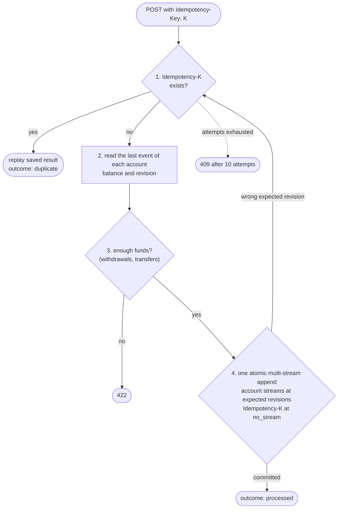
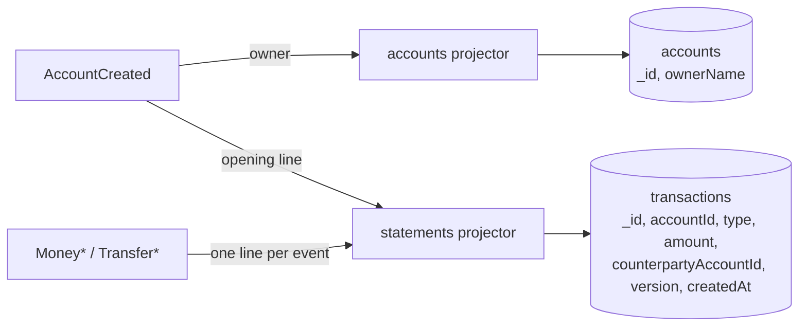

# Idempotent Ledger

An event-sourced ledger with CQRS. It demonstrates idempotent commands, optimistic concurrency, atomic multi-account writes and a rebuildable read model. It is not a payment rail or a bank core.


## Architecture

The write and read sides are separate processes that only meet through the event store.

| Component | Role | Technology |
| --- | --- | --- |
| **KurrentDB** ([formerly EventStoreDB](https://www.kurrent.io/)) | Source of truth: every fact is an immutable event | KurrentDB 26.2 |
| **MongoDB** | Disposable read model: account owners and statement lines | MongoDB 9.0 |
| **api** | Decides and appends commands, answers queries | Bun, Elysia |
| **projections** | Runs every projector, each in its own KurrentDB consumer group | Bun (same image as `api`) |
| **web** | Account view and concurrency lab | React 19, Vite, Tailwind, served by Caddy |

`api` and `projections` hold no state. Optimistic concurrency keeps concurrent API writers consistent, and consumer groups share events across projection replicas (`compose.yml` runs two).


## Event model

There is one stream per account, and every event carries its `accountId`. An account exists once its stream holds `AccountCreated`.

```text
Account-{accountId}    AccountCreated   { accountId, ownerName, balance }
                       MoneyDeposited   { accountId, amount, balance }
                       MoneyWithdrawn   { accountId, amount, balance }
                       TransferSent     { accountId, transferId, counterpartyAccountId, amount, balance }
                       TransferReceived { accountId, transferId, counterpartyAccountId, amount, balance }
Idempotency-{key}      RequestProcessed { balance }
```

Every event carries the balance it leaves behind, so each one is a snapshot written in the same atomic append. Loading an account reads a single event, its last, whatever the stream's length. Commands load from the event store and never from MongoDB, so a lagging read model cannot let a withdrawal or transfer through without funds.

Corrections are new events, never edits. Streams grow forever; at scale they would be closed per period, with a closing event carrying the balance into a new stream.

Accounts are not opened through the API. `apps/api/scripts/migrate.ts` is a one-off migration that appends `AccountCreated` for three demo accounts. It can be re-run safely, because each append expects `no_stream`.

## Commands



- **Optimistic concurrency** uses the stream revision. There are no locks: a conflicting append fails and the command retries from a fresh read, up to 10 attempts.
- **Atomic transfers**: both legs and the idempotency record commit together or not at all (`multiStreamAppend`, KurrentDB 25.1+).
- **Idempotency** is a stream that can only be created once. Concurrent requests with the same key race on `no_stream`; the loser retries, finds the record and replays it.
- **The idempotency record lives in the event store** because it shares the atomic append with the money. A key kept in Redis or the read model would be a dual write: a crash between the two either loses the key, moving money twice on retry, or keeps a key for an append that never happened.

`Idempotency-Key` is optional. Without it every request is processed; with it the request takes effect once and retries replay the saved result. Only committed commands are recorded, so a request rejected with `422` is evaluated again on retry.

## Read model

Each view has its own projector and its own persistent subscription on `$all`, filtered to `Account-*`. KurrentDB keeps each group's checkpoint, retries failed events and parks them after too many attempts, so one broken view does not stall the others.



Replicas mean events can arrive out of order or twice, so writes are idempotent and order-independent: statement lines are upserted by event id, and the account document is keyed by account id. The statement is sorted by stream revision, and the counterparty's name is joined at read time (`$lookup` on `accounts`), so the statements projector depends on no other view.

Balance is deliberately not in the read model. `GET /api/accounts/:accountId` reads it from the last event of the stream, so it is never stale, while the statement can trail it slightly.

To rebuild a view, drop its collection and reset its consumer group to the start. A new view gets the whole history the same way.

## Getting started

Requires Docker. Create `.env` in the repository root:

```text
MONGODB_PORT=27017
PORT=3000
API_PORT=3001
```

Start the stack, then create the demo accounts:

```bash
make up
```

```bash
make migrate
```

```bash
make down
```