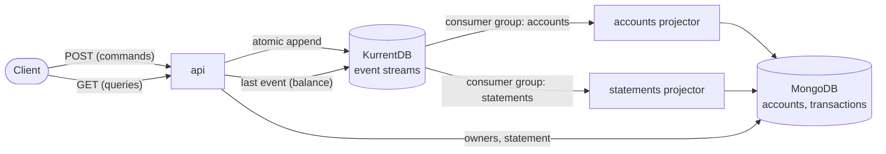

# Idempotent Ledger

An event-sourced ledger with CQRS. It shows idempotent commands, optimistic concurrency, atomic multi-account writes and a rebuildable read model. It is not a payment rail or a bank core.


## Architecture

The write side and the read side are separate processes. They meet only through the event store. Neither holds state: concurrent writers stay consistent through optimistic concurrency, and projection replicas share a consumer group's events (`compose.yml` runs two).

| Component | Role |
| --- | --- |
| **KurrentDB** ([formerly EventStoreDB](https://www.kurrent.io/)) | Source of truth. Every fact is an immutable event. |
| **MongoDB** | Disposable read model: account owners and statement lines. |
| **api** | Decides, appends, and answers queries. |
| **projections** | One projector per view, each with its own KurrentDB consumer group. |
| **web** | Account view and concurrency lab. |



## Event model

One stream per account. The account exists once the stream holds `AccountCreated`. Every event carries its `accountId` and the balance it leaves behind, so the last event is the account. Loading an account reads that single event, at any stream length. Commands read the event store. A lagging projection cannot authorize a withdrawal the stream would refuse.

```text
Account-{accountId}    AccountCreated   { accountId, ownerName, balance }
                       MoneyDeposited   { accountId, amount, balance }
                       MoneyWithdrawn   { accountId, amount, balance }
                       TransferSent     { accountId, transferId, counterpartyAccountId, amount, balance }
                       TransferReceived { accountId, transferId, counterpartyAccountId, amount, balance }
Idempotency-{key}      RequestProcessed { balance }
```

Corrections are new events. Streams grow without bound. Closing the books, later, would be an event that carries the balance into a new stream.

## Commands

- **Optimistic concurrency** is the stream revision. There are no locks. A conflicting append fails, the command reloads and retries, up to 10 times, then answers `409`.
- **A transfer is one `multiStreamAppend`** (KurrentDB 25.1+). Both legs and the idempotency record commit together, or not at all.
- **Idempotency is a stream**, `Idempotency-{key}`, that can be created only once. Two requests with the same key race on `no_stream`. The loser retries, finds the record and replays the saved balance. The record is written in the same append as the money. A key kept beside the append, in Redis or MongoDB, splits that write: a crash between the two either drops the key, so the retry moves money twice, or keeps a key for an append that never happened.
- **`Idempotency-Key` is optional.** Without it, every request is applied. With it, the effect happens once. A `422` for insufficient funds is not recorded, so the retry is decided again.

## Read model

Each view has its own persistent subscription on `$all`, filtered to `Account-*`. KurrentDB stores the checkpoint, retries a failed event and parks it, so one broken view does not stall the others.

`accounts` stores `{ _id, ownerName }`, written once from `AccountCreated`. `transactions` stores one line per event, upserted by event id and ordered by stream revision:

```text
_id, accountId, type, amount, counterpartyAccountId, version, createdAt
```

The counterparty name is a `$lookup` at read time, so the statements projector depends on no other view. Replicas can deliver an event twice or out of order. Both writes stay correct without coordination.

Balance is not projected. `GET /api/accounts/:accountId` reads the last event, so the balance is the stream's. The statement can trail it by a few events.

Drop a collection and reset its consumer group to rebuild that view. A new view starts the same way and receives the whole history.

## Getting started

Requires Docker. Create `.env` in the repository root:

```text
MONGODB_PORT=27017
PORT=3000
API_PORT=3001
```

```bash
make up       # stack
make migrate  # three demo accounts; safe to re-run, each append expects no_stream
make down
```
