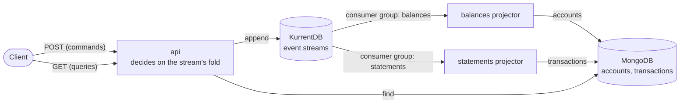
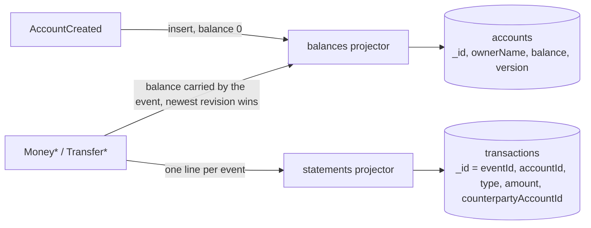
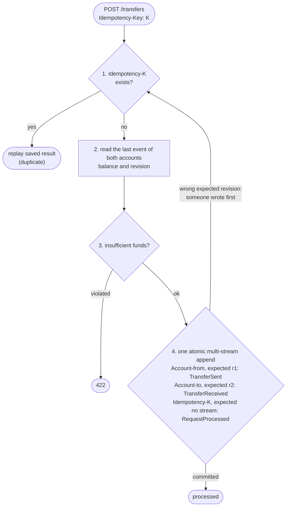

## What this is

An event-sourced ledger with CQRS, split into processes that only meet through the event store:

- **KurrentDB** ([formerly EventStoreDB](https://www.kurrent.io/)) is the source of truth. Every fact, from opening an account to moving money, is an immutable event.
- **MongoDB** holds the read model: one document per account and one per statement line, projected from the events.
- **api** decides and appends. **projections** runs every projector, each in its own KurrentDB consumer group, and writes its view in MongoDB. Both are stateless and scale by replicas: optimistic concurrency keeps the API consistent, and the consumer groups share events across projection replicas.

It is not a payment rail or a bank core. It shows idempotent commands, optimistic concurrency, atomic multi-account writes, and a rebuildable read model.



## Model

One stream per account. The account exists once its stream holds `AccountCreated`. Every event carries the `accountId` it belongs to.

```text
Account-{accountId}    AccountCreated   { accountId, ownerName, balance }
                       MoneyDeposited   { accountId, amount, balance }
                       MoneyWithdrawn   { accountId, amount, balance }
                       TransferSent     { accountId, transferId, counterpartyAccountId, amount, balance }
                       TransferReceived { accountId, transferId, counterpartyAccountId, amount, balance }
Idempotency-{key}      RequestProcessed { balance }
```

```text
balance = the balance carried by the account's last event
```

Commands rebuild the account from the event store, never from MongoDB, so a lagging read model can never let a withdrawal or transfer through without funds. Every movement carries the balance it leaves behind, so loading an account reads one event, its last, whatever the stream's length: each event is its own snapshot, written in the same atomic append.

Streams still grow forever. At scale they would be closed per period ("closing the books"): a closing event carries the balance into a new stream, and old streams move to cold storage.

Corrections are new events, never edits.

## Read model

Each view of the read model has its own projector and its own persistent subscription on `$all` (filtered to `Account-*`). KurrentDB keeps each group's checkpoint, retries a failed event and parks it after too many attempts, so one broken view never stalls the others. All projectors run in the single `projections` process; its replicas split each group's events.



So one view can fail, lag, be rebuilt or be deployed without touching the others, and a new view (a report, notifications) starts from the first event and gets the whole history. The counterparty's name is joined at read time (`$lookup` on `accounts`), so the statements projector depends on no other view.

Replicas mean events can arrive out of order or twice, so every write is order-independent and idempotent: statement lines are upserted by event id, and each movement carries the balance it leaves behind, applied only when its revision is newer than the account's `version`.

The read model is disposable: drop a collection and reset its consumer group to the start, and its projector rebuilds it from the events. Reads are eventually consistent, typically a few milliseconds behind the writes, and the two views may briefly disagree with each other.

## A command



- **Optimistic concurrency** is the stream revision. No locks; a conflicting append fails and the command retries from a fresh read.
- **Atomic transfers**: both legs and the idempotency record commit together or not at all (`multiStreamAppend`, KurrentDB 25.1+).
- **Idempotency** is a stream that can be created only once. Two concurrent requests with the same key race on `no_stream`; the loser retries, finds the record and replays it.
- **Idempotency lives in the event store** because it is written in the same atomic append as the money. A key kept in Redis or the read model would be a dual write: a crash between the two either loses the key (the retry moves money twice) or keeps a key for an append that never happened.

Accounts are not opened by the API: they come from an external, one-off migration that appends `AccountCreated` (with its opening balance) to each `Account-{id}` stream. Every event carries a balance, so the last one is always the account's state.

Without `Idempotency-Key`, every request is processed. With it, the request is processed once and every retry replays the saved response.

## Code

```text
apps/api/src/
  server.ts                         composes the features into one Elysia app
  features/
    ledger/                         write side (KurrentDB)
      ledger.events.ts              event types and payloads
      ledger.store.ts               load account (last event), atomic append, idempotency
      commands/
        command.ts                  shared: idempotency, funds check, optimistic retry
        deposit.ts, withdraw.ts, transfer.ts   one file per command
      ledger.routes.ts              POST /accounts/:id/deposits, /withdrawals, /transfers
    projection/                     read side (MongoDB)
      projection.store.ts           MongoDB collections
      projections.ts                runs every projector, one consumer group each
      projectors/
        balances.projector.ts       accounts view: owner and balance
        statements.projector.ts     transactions view: one line per movement
      projection.routes.ts          GET /accounts, /accounts/:id

apps/api/tests/features/ledger/ledger.test.ts   end-to-end against real KurrentDB and MongoDB
```

The only business rule is the funds check. Every endpoint answers `{ data }`. Errors are plain `new Error(message, { cause: status })`; one `onError` turns them into `{ message }` with that status.

## Getting started

`Docker` is the only requirement. Create `.env` in the repo root:

```text
KURRENTDB_URL=kurrentdb://localhost:2113?tls=false

MONGODB_PORT=27017
MONGODB_URL=mongodb://localhost:27017/banking-ledger

PORT=3000
API_PORT=3001
```

```bash
make up      # KurrentDB, MongoDB, API, projections and web
make down    # stop everything
make test    # API tests against throwaway KurrentDB and MongoDB
```

Web on `localhost:3000`, API on `localhost:3001` (OpenAPI at `/api/docs`), KurrentDB UI on `localhost:2113`. In the web app, pick an account and run the concurrency lab: with an idempotency key four parallel deposits collapse into one; without it all four apply and none is lost.

## Where the guarantee ends

```text
covered
  atomic, append-only writes across accounts
  idempotent effect per key
  constant-time account load: the last event carries the balance
  optimistic concurrency without lost updates
  full audit trail: the stream is the history
  effectively-once projection into MongoDB (idempotent, order-independent writes)

not covered
  closing the books per period, idempotency-record expiry, input validation beyond the amount
  read-your-writes on queries, currencies/FX, authentication
  external payment rails, HA/DR
```

## Preview


