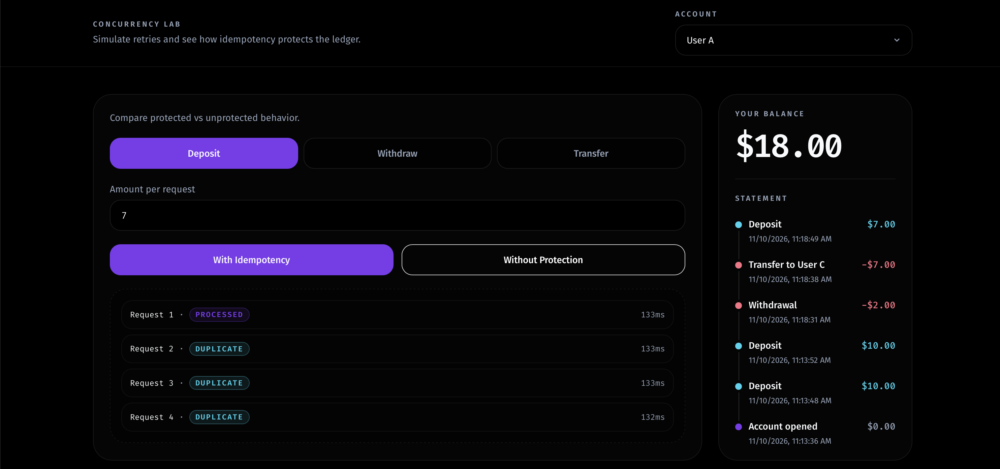
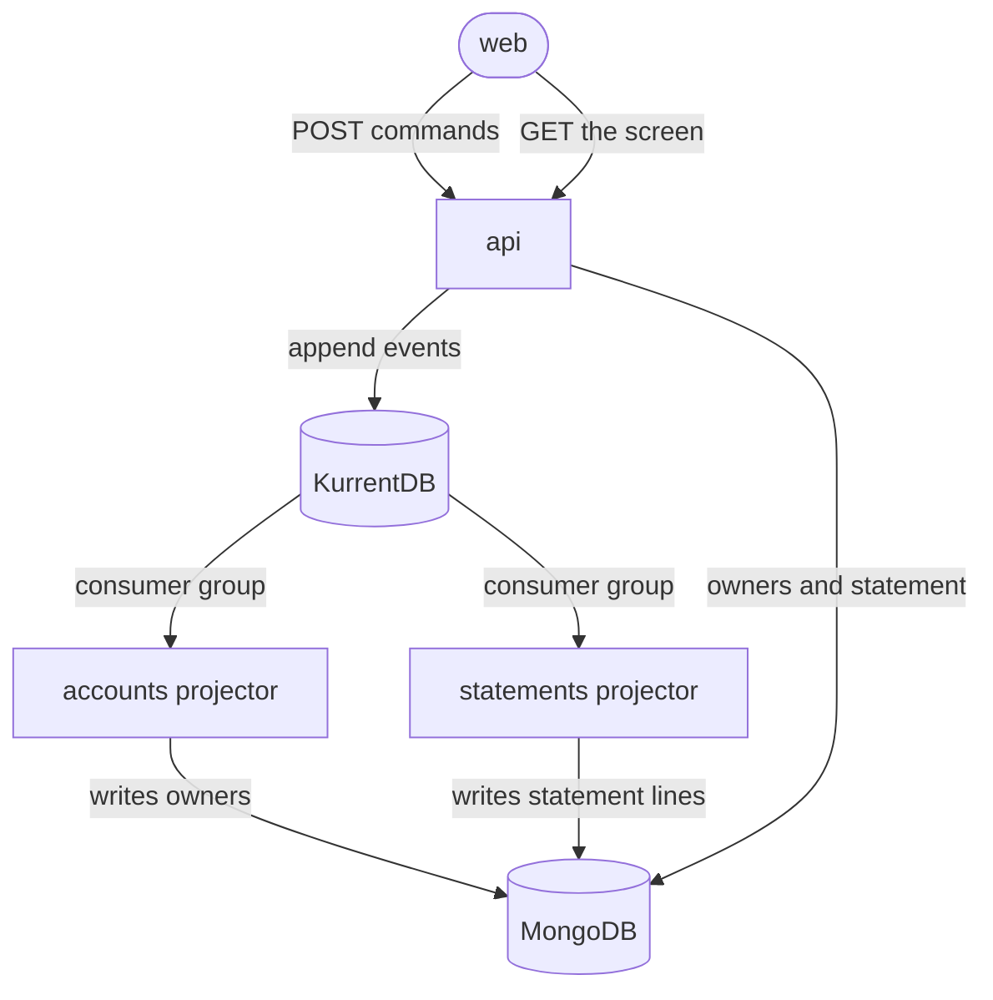

# Idempotent Ledger

An event-sourced ledger with CQRS. It shows idempotent commands, optimistic concurrency, atomic multi-account writes and a rebuildable read model. It is not a payment rail or a bank core.





## Commands

- **Optimistic concurrency** is the stream revision. There are no locks. A conflicting append fails, the command reloads and retries, up to 10 times, then answers `409`.
- **A transfer is one `multiStreamAppend`** (KurrentDB 25.1+). Both legs and the idempotency record commit together, or not at all.
- **Idempotency is a stream**, `Idempotency-{key}`, that can be created only once. Two requests with the same key race on `no_stream`. The loser retries, finds the record and replays the saved balance. The record is written in the same append as the money. A key kept beside the append, in Redis or MongoDB, splits that write: a crash between the two either drops the key, so the retry moves money twice, or keeps a key for an append that never happened.
- **`Idempotency-Key` is optional.** Without it, every request is applied. With it, the effect happens once. A `422` for insufficient funds is not recorded, so the retry is decided again.

## Getting started

Requires Docker. Create `.env` in the repository root:

```text
MONGODB_PORT=27017
PORT=3000
API_PORT=3001
```

```bash
make up       # stack
make migrate  # create demo accounts; safe to re-run, each append expects no_stream
make down
```
